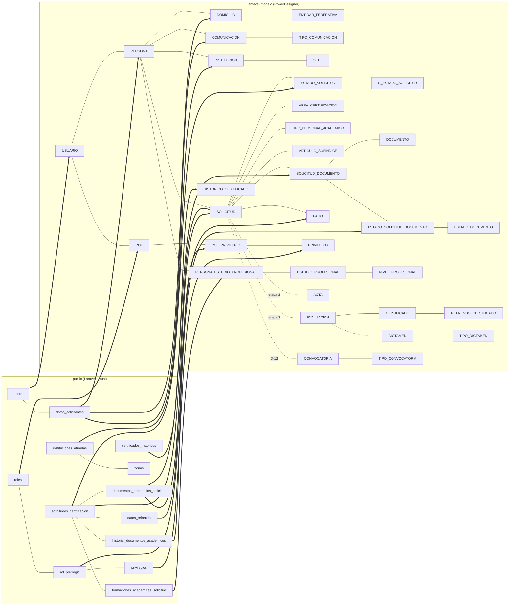

# Plan de integración funcional del modelo PowerDesigner (PDM)

> Rama `integracion/pdm-funcional` · base `desarrollo/anfeca-pruebas` @ `4498f2b` · 20/11/2026
> **Objetivo:** que ANFECA_PRUEBAS **guarde, consulte y actualice** su información en las tablas de `anfeca_modelo`, con sus relaciones y restricciones, sin perder ninguna funcionalidad ni dato de `public`.
> **Estado:** propuesta para aprobación. Las decisiones marcadas **D-n** requieren autorización antes de implementarse.

---

## 1. Diagnóstico del punto de partida

| Elemento | Situación |
|---|---|
| Código | Escribe en 9 puntos: `DatosSolicitante@store/update/autorizar`, `SeleccionCertificacion@store`, `DatoRefrendo@store`, `FormacionAcademica@store/autorizar`, `DocumentoProbatorio@store`, `AceptacionCompromiso@guardar`, `RegistroCompletado@confirmar`. Lee en: middleware `datos.autorizados`, `ConsultaAntecedentesService`, Panel, Completado, Acuse y descargas. |
| `public` | 25 tablas: **15 de dominio** y **10 técnicas de Laravel**. Las técnicas se quedan en `public`: `cache`, `cache_locks`, `jobs`, `job_batches`, `failed_jobs`, `sessions`, `password_reset_tokens`, `migrations`; `users` se trata en D-1. |
| `anfeca_modelo` | 36 tablas y 35 FK, vacías. Llaves `SERIAL`, nombres en minúsculas, fecha y hora en columnas separadas. |
| Sin uso en el código | `roles`, `privilegios`, `rol_privilegio`, `zonas` y `coordinador_zona` solo tienen datos. |
| Tablas antiguas por usuario | `formaciones_academicas`, `documentos_probatorios` y `selecciones_certificacion`. **Panel** todavía lee `formaciones_academicas`, así que puede mostrar un avance incorrecto en el flujo por solicitud. |
| Folio | El acuse usa `solicitudes_certificacion.id` como folio. |

### Incompatibilidades estructurales que impiden copiar los datos tal cual

1. **Columnas obligatorias sin dato en Laravel:**
   - `INST_FACULTAD`, `INST_ZONA` e `INST_NUMERO_AFILIACION` (7 caracteres).
   - `USUA_ID_PERSONA`: un usuario sin datos personales, como un administrador, no puede tener `USUARIO`.
   - `PERS_CURP`: en Laravel es *nullable*.
2. **Longitudes menores en el PDM** que en Laravel, con riesgo de truncar:

   | PDM | Laravel |
   |---|---|
   | `DOMI_CALLE` 170 | 200 |
   | `DOMI_NUMERO_EXT` 6 | 20 |
   | `DOMI_NUMERO_INT` 4 | 20 |
   | `PERS_APELLIDO_*` 60 | 100 |

3. **Datos que el PDM no tiene dónde guardar** (los usan funcionalidades validadas):
   - autorización de datos y su fecha;
   - colonia, municipio y código postal del domicilio (`DOMICILIO` no tiene FK a `COLONIA`);
   - compromiso de entrega;
   - formación completada;
   - títulos «Otro»;
   - **ruta del archivo** de cada documento (`SOLICITUD_DOCUMENTO` no tiene URL);
   - formación por **solicitud** (`PERSONA_ESTUDIO_PROFESIONAL` es por persona);
   - vínculo solicitud ↔ certificado histórico;
   - vinculación usuario ↔ histórico;
   - tipo de trámite y certificación (ANFECA/CACSLA/CACECA);
   - `remember_token` de la sesión.
4. **Diferencia conceptual en el histórico de certificados.**
   - `certificados_historicos` es **una fila por persona** con `primera_vez` y `refrendo_1…7`, tal como viene del Excel.
   - `HISTORICO_CERTIFICADO` es **una fila por certificado**, con año, tipo y folio.
5. **Diferencia conceptual en el refrendo.**
   - `REFRENDO_CERTIFICADO` exige `RECE_ID_CERTIFICADO` → `CERTIFICADO` → `EVALUACION`: representa un refrendo **ya emitido tras la evaluación**.
   - Los datos que se capturan al solicitar (art. 13/14, inciso) caben en `SOLICITUD` (`SOLI_ART13`, `SOLI_ART14`, `SOLI_ID_ARTICULO`).

La integración funcional **no puede ser una copia directa**. Requiere transformar datos y, para los casos del punto 3, **extender el PDM** (D-2).

---

## 2. Arquitectura propuesta: expandir, migrar y contraer

**La misma conexión `pgsql` y la misma base.**
- Los modelos nuevos usan tablas calificadas (`anfeca_modelo.persona`).
- No se cambia la conexión de Laravel.
- Una transacción abarca ambos esquemas, así que escribir en los dos es **atómico**.

**Se conservan los identificadores:**

| PDM | Valor |
|---|---|
| `PERS_ID_PERSONA` | `datos_solicitantes.id` |
| `USUA_ID_USUARIO` | `users.id` |
| `SOLI_ID_SOLICITUD` | `solicitudes_certificacion.id` |
| `SOLI_FOLIO_SOLICITUD` | `solicitudes_certificacion.id`, el folio actual del acuse |

Después de migrar, `setval` ajusta las secuencias. Las URL, el folio y las relaciones existentes no cambian.

**Interruptor de modo** (`ANFECA_PDM_MODO` en `.env`; por omisión `apagado`):

| Modo | Escritura | Lectura | Reversión |
|---|---|---|---|
| `apagado` | Solo `public` (como hoy) | `public` | — |
| `espejo` | `public` + PDM en la **misma transacción** | `public` | Volver a `apagado`: inmediato, sin pérdida |
| `principal` | PDM + `public` en espejo | **PDM** | Volver a `espejo`: `public` está al día |
| `exclusivo` | Solo PDM; `public` de dominio congelado como archivo | PDM | Restaurar respaldo + `espejo` (procedimiento ensayado en F5) |

**Código:**
- `app/Models/Pdm/*`: 36 modelos Eloquent, con `$table = 'anfeca_modelo.x'`, PK explícita, `$timestamps = false` y relaciones para las 35 FK y las nuevas.
- `app/Services/Pdm/*`:
  - **sincronizadores**, para escribir en el PDM;
  - **lectores**, que devuelven a controladores y vistas la misma estructura de datos que hoy, para que Blade y Vue **no cambien**;
  - `CatalogosPdm`, que resuelve los ID de catálogo por clave estable.
- Los controladores solo cambian en sus 9 puntos de escritura y en las lecturas. La validación, los mensajes y el flujo se conservan.

**Herramientas:**

| Comando | Función |
|---|---|
| `anfeca:pdm-migrar` | En seco por defecto. Una transacción, idempotente; se niega si hay datos no catalogados. |
| `anfeca:pdm-conciliar` | Solo lectura. Compara `public` con el PDM campo por campo; termina con código 1 si hay diferencias. |
| `anfeca:pdm-modo` | Muestra el modo y valida las precondiciones antes de cambiarlo. |

---

## 3. Mapeo completo `public` → `anfeca_modelo`

Leyenda de transformación:
- **=** copia directa.
- **T** transformación documentada.
- **E** requiere extensión del PDM (D-2).
- **D** requiere decisión.
- **—** sin destino (técnico o legado).

### 3.1 Identidad y contacto

| `public` | `anfeca_modelo` | Regla |
|---|---|---|
| `datos_solicitantes.id` | `persona.pers_id_persona` | = (ID conservado) |
| `.nombres`, `.apellido_paterno`, `.apellido_materno` | `pers_nombre`, `pers_apellido_paterno`, `pers_apellido_materno` | = · Longitud 100 → 60: **D-4** |
| `.curp` / `.rfc` | `pers_curp` / `pers_rfc` | = · CURP nula: **D-5** |
| `.genero` | `pers_genero` (1 carácter) | T: Femenino → `F`, Masculino → `M` |
| `.cedula_profesional` | `persona.pers_cedula_profesional` | **E** |
| `.datos_autorizados`, `.fecha_autorizacion` | `persona.pers_datos_autorizados`, `pers_fecha_autorizacion` | **E** |
| — | `pers_activo` | T: `true` (divergencia 1) |
| `formaciones_academicas_solicitud.institucion_afiliada_id` (de la última solicitud) | `pers_id_institucion` | T (divergencia 1) |
| `users.id`, `.email`, `.password`, `.rol` | `usuario.usua_id_usuario`, `usua_nombre`, `usua_contrasenia` (hash bcrypt), `usua_id_rol` | T · ver **D-1** |
| — | `usua_estatus` | T: `ACTIVO` (divergencia 2) |
| `users.remember_token`, `email_verified_at` | `usuario.usua_remember_token` | **E** (solo con D-1 = B) |
| `.calle`, `.numero_exterior`, `.numero_interior` | `domicilio.domi_calle`, `domi_numero_ext`, `domi_numero_int` | = · Longitudes: **D-4** |
| `.entidad_federativa` (texto) | `domi_id_entidad_federativa` → `entidad_federativa` | T: catálogo INEGI de 32 entidades; se compara el texto normalizado y lo que no coincide se reporta y no se inventa |
| `.colonia`, `.municipio`, `.codigo_postal` | `domicilio.domi_colonia`, `domi_municipio`, `domi_codigo_postal` | **E** · `COLONIA` y `ALCALDIA_MUNICIPIO` quedan para un catálogo SEPOMEX futuro (**D-6**) |
| `.telefono_particular`, `.telefono_celular`, `.correo_electronico` | `comunicacion` (una fila por valor) + `tipo_comunicacion` | T: tipos `TEL_PARTICULAR`, `TEL_CELULAR`, `CORREO` |

### 3.2 Catálogos de certificación

| `public` | `anfeca_modelo` | Regla |
|---|---|---|
| `solicitudes.area_certificacion` (texto) | `soli_id_area_certificacion` → `area_certificacion` | T: semilla con las 5 áreas de `SeleccionCertificacion.vue` y `config/anfeca_equivalencias.php` |
| `solicitudes.tipo_personal` (texto) | `soli_id_tipo_personal_academico` → `tipo_personal_academico` | T: semilla con los tipos de `SeleccionCertificacion.vue` |
| `datos_refrendo.inciso_articulo_14` | `soli_id_articulo` → `articulo_subindice` | T: semilla `13.1`, `14.1`, `14.2`, `14.3` |
| `solicitudes.certificacion` (ANFECA/CACSLA/CACECA) | `solicitud.soli_certificacion` **E**, o `tipo_convocatoria` | **D-7** |

### 3.3 Solicitud y trámite

| `public` | `anfeca_modelo` | Regla |
|---|---|---|
| `solicitudes_certificacion.id` | `solicitud.soli_id_solicitud` y `soli_folio_solicitud` | = (folio actual del acuse; divergencia 4) |
| `.user_id` | `soli_id_persona` | T: mediante `datos_solicitantes.user_id` |
| `.created_at` | `soli_fecha_registro_solicitud` | T: fecha local America/Mexico_City |
| `.tipo_tramite` | `solicitud.soli_tipo_tramite` | **E** |
| `.certificado_historico_id` | `solicitud.soli_id_historico_certificado` (FK) **E** + `soli_numero_certificado` (texto) | T (divergencia 4) |
| `.estado`, `.fecha_envio` | `estado_solicitud` (bitácora) + `c_estado_solicitud` | T: un registro por evento, `Borrador (BO)` al crear y `Enviada (EN)` al enviar; `esso_motivo_rechazo` = null hasta el módulo de revisión (divergencia 5) |
| `.compromiso_aceptado`, `.compromiso_aceptado_en` | evento `Compromiso aceptado (CA)` en `estado_solicitud` | T (**D-3**) |
| `datos_refrendo.aplica_articulo_14` | `soli_art14` | = |
| — | `soli_art13` | T: `refrendo AND NOT art14` (**D-8**) |
| `datos_refrendo.refrendo_actual` | se recalcula desde `historico_certificado` | T |
| `datos_refrendo.numero_refrendo_asignado` | `refrendo_certificado.rece_numero_refrendo` (cuando se emita) | Hoy siempre nulo en el flujo; no se migra a `REFRENDO_CERTIFICADO` (divergencia 7) |
| `selecciones_certificacion` | Sus datos ya están en `solicitud` | — (legado; se sigue escribiendo en `espejo`) |

### 3.4 Histórico de certificados

| `public` | `anfeca_modelo` | Regla |
|---|---|---|
| `certificados_historicos` (1 fila por persona) | `historico_certificado` (1 fila por evento) | T: `primera_vez` → tipo `PRIMERA_VEZ`; `refrendo_n` → tipo `REFRENDO n`; año = valor de la celda |
| `.numero_certificado` | `hice_numero_certificacion` (4) / `hice_folio_certificado` (7) | T: el número tiene hasta 7 dígitos (regla `^[0-9]{1,7}$`) y va al **folio** (divergencia 6) |
| `.curp_historica` | `hice_curp` | = |
| — | `hice_area_certificacion` | Nulo: el Excel no lo trae (divergencia 6) |
| `.user_id`, `.estado_vinculacion`, `.certificacion`, nombres y correo | `historico_certificado_importacion` (tabla de **extensión**, copia fiel del Excel) | **E** · `ConsultaAntecedentesService` valida contra la extensión y escribe eventos normalizados (**D-9**) |

### 3.5 Formación académica

| `public` | `anfeca_modelo` | Regla |
|---|---|---|
| Cada `formaciones_academicas_solicitud` | **2 filas** `persona_estudio_profesional`: origen y último grado | T |
| `.nivel_*` | `estudio_profesional.espr_id_nivel_profesional` → `nivel_profesional` | T: semilla Licenciatura, Especialidad, Maestría, Doctorado |
| `.titulo_*` | `pees_id_estuido_profesional` → `estudio_profesional` | T: catálogo con los títulos de `FormacionAcademica.vue` |
| `.titulo_*_otro` | Fila en `estudio_profesional` con `espr_estado = 'REV'` (sujeto a revisión) | T: el texto libre se conserva literal (**D-10**) |
| `.titulo_*_archivo`, `.cedula_*_archivo` | `pees_url_titulo`, `pees_url_cedula` | = (rutas de Storage sin cambios) |
| `.solicitud_id` | `persona_estudio_profesional.pees_id_solicitud` + `pees_tipo` (`ORIGEN`/`ULTIMO`) | **E**: la etapa 1 exige captura **por trámite** |
| `.formacion_completada_at` | evento `Formación autorizada (FA)` en `estado_solicitud` | T (**D-3**) |
| — | `pees_cedula` | Nulo: Laravel no captura el número de cédula, solo el archivo (divergencia 8) |

### 3.6 Documentos y pago

| `public` | `anfeca_modelo` | Regla |
|---|---|---|
| Cada archivo de `documentos_probatorios_solicitud`: constancia, solicitud art. 14, constancia art. 14 | `solicitud_documento` + catálogo `documento` + `socu_url_archivo` **E** | T: una fila por archivo |
| `.comprobante_pago_archivo` | `pago.pago_url_comprobante` + fila en `solicitud_documento` | T: `PAGO` es el registro de pago y `SOLICITUD_DOCUMENTO`, el expediente |
| `.link` | `solicitud_documento` con el documento `ENLACE_EVIDENCIAS` y la URL en `socu_url_archivo` | T |
| `historial_documentos_academicos` | Filas anteriores en `solicitud_documento`; el estado `SUSTITUIDO` va en `estado_solicitud_documento` | T: la versión vigente es la más reciente con estado `CARGADO` |
| Cada carga o reemplazo | `estado_solicitud_documento` + `estado_documento` (`CARGADO`, `SUSTITUIDO`; luego `VALIDADO` y `RECHAZADO`) | T |

### 3.7 Administración

| `public` | `anfeca_modelo` | Regla |
|---|---|---|
| `roles`, `privilegios`, `rol_privilegio` | `rol`, `privilegio`, `rol_privilegio` | = (ID conservados) · `roles.nombre` 20 ↔ `ROL_NOMBRE` 150 |
| `instituciones_afiliadas` | `institucion` (+ `sede` desde `.sede`/`.campus`) | T · `INST_FACULTAD`, `INST_ZONA` e `INST_NUMERO_AFILIACION` obligatorias: **D-11** (divergencia 3) |
| `zonas`, `coordinador_zona` | `inst_zona` (siglas) e `ins_coord_regional_cert_academi` (texto) | T · o tablas de extensión `zona` y `coordinador_zona`: **D-11** |
| `formaciones_academicas`, `documentos_probatorios` (antiguas, por usuario) | — | Se conservan como archivo; no se migran (los datos vigentes son los de por solicitud). Panel deja de leerlas. |

### 3.8 Las 14 tablas del PDM sin equivalente directo

| Tabla | Uso desde esta integración |
|---|---|
| `c_estado_solicitud` | **Se usa ya**: catálogo de eventos y estados (BO, FA, CA, EN; luego revisión y rechazo) |
| `documento` | **Se usa ya**: catálogo de los 9 tipos de documento del expediente (4 académicos, constancia de antigüedad, comprobante de pago, 2 del art. 14 y el enlace de evidencias) |
| `estado_documento` | **Se usa ya**: catálogo de estados de documento |
| `estado_solicitud_documento` | **Se usa ya**: historial de carga y sustitución de cada archivo |
| `articulo_subindice` | **Se usa ya**: incisos 13.1, 14.1, 14.2, 14.3 |
| `entidad_federativa` | **Se usa ya**: 32 entidades (INEGI) |
| `tipo_comunicacion` | **Se usa ya**: teléfono particular, celular, correo |
| `tipo_convocatoria` | **Se usa ya** si se elige D-7 = B |
| `convocatoria` | Necesita **datos reales tuyos**: nombre, monto, fechas y puntuaciones. Mientras no existan, `soli_id_convocatoria` queda nulo (es *nullable*). **D-12** |
| `evaluacion`, `dictamen`, `tipo_dictamen`, `acta`, `certificado` | Pertenecen a procesos que **aún no existen**: evaluación, dictamen, acta de sesión, emisión del certificado. Se dejan **modelos, relaciones y pruebas de FK listos**, pero no se cargan datos, porque cualquier fila sería inventada. Su llenado es la etapa 2 (módulo administrativo). |

**Resultado** (recuento de las 36):
- **26 tablas en uso operativo desde F3**: 27 con D-7 = B.
- **3 dependen de datos que hay que proporcionar**: `colonia` y `alcaldia_municipio` (catálogo SEPOMEX, D-6) y `convocatoria` (D-12).
- **6 corresponden a módulos de la etapa 2**: `evaluacion`, `dictamen`, `tipo_dictamen`, `acta`, `certificado` y `refrendo_certificado`. Quedan con modelos, relaciones y pruebas de FK listos.

---

## 4. Las 8 divergencias del diagnóstico: resolución

| # | Divergencia | Resolución propuesta |
|---|---|---|
| 1 | `pers_id_institucion`, `pers_activo` | Institución de la formación más reciente; `activo = true` |
| 2 | `usua_estatus` | `ACTIVO` (no hay bloqueo de cuentas en Laravel) |
| 3 | `inst_facultad` | **D-11**: dato que debes proporcionar; el campus no es la facultad |
| 4 | `soli_numero_certificado`, `soli_folio_solicitud` | El número del certificado validado (refrendo) o nulo (inicial); folio = id (el mismo que muestra el acuse) |
| 5 | `esso_motivo_rechazo` | Nulo hasta el módulo de revisión |
| 6 | `hice_folio_certificado`, `hice_area_certificacion` | Folio = número de certificado; área nula (el Excel no la tiene) |
| 7 | `rece_id_certificado`, `rece_anio_refrendo` | `REFRENDO_CERTIFICADO` es el refrendo **emitido**; la solicitud de refrendo vive en `SOLICITUD` |
| 8 | `pees_cedula` | Nulo: solo se captura el archivo de la cédula. **D-10** decide si se agrega el número al formulario. |

---

## 5. Decisiones que requieren tu autorización

### Decisiones ya tomadas (20/11/2026)

| ID | Decisión |
|---|---|
| D-1 | **A:** `public.users` sigue como tabla técnica de autenticación, 1:1 con `USUARIO` (mismo ID y rol). Pasar el login a `USUARIO` se revisa en F5. |
| D-2 | **Autorizadas** las extensiones aditivas de la sección 6. Se entregará el SQL para actualizar el `.pdm`. |
| Transición | **Por modos** `apagado → espejo → principal → exclusivo`, con conciliación obligatoria antes de cada cambio |
| Seguridad | Autorizadas y entregadas en la rama `fix/seguridad-anfeca`: volcados fuera de Git, P4, P5, P6, P9, V8 y guías de V1/V2 |

**Pendientes:**
- D-3 y D-7 a D-10: si no hay objeción, se toma la recomendación de la tabla.
- D-4, D-5 y D-11: se cierran con el resultado de las consultas de la sección 12.
- D-12: depende de que existan convocatorias reales.

| ID | Decisión | Recomendación |
|---|---|---|
| **D-1** | Autenticación. A: `public.users` se mantiene como tabla técnica de autenticación, 1:1 con `USUARIO` (mismo ID, hash sincronizado). B: el modelo `User` se mueve a `anfeca_modelo.usuario` (requiere `usua_remember_token`). | **A** hasta F4. **B** en F5, si se aprueba. |
| **D-2** | **Extender el PDM** con columnas y tablas aditivas en `anfeca_modelo`. Sin esto se pierden la autorización, el compromiso, las rutas de archivos, el domicilio completo, «Otro» y la formación por trámite. Las extensiones se reflejan después en PowerDesigner. | Autorizar la lista de la sección 6 |
| **D-3** | Representar «formación autorizada» y «compromiso aceptado» como **eventos** en `ESTADO_SOLICITUD` (usa el PDM tal cual y da historial), o como columnas de extensión | Eventos |
| **D-4** | Longitudes del PDM menores que las de Laravel. Ampliar las columnas del PDM, o endurecer la validación al tamaño del PDM. | Ampliar el PDM tras medir el dato real más largo (consulta A de la sección 12) |
| **D-5** | Personas con CURP nula: excluirlas de `PERSONA` y reportarlas, o permitir nulo | Reportar y decidir caso por caso |
| **D-6** | `COLONIA` y `ALCALDIA_MUNICIPIO` necesitan el catálogo SEPOMEX | Texto de extensión ahora; catálogo después |
| **D-7** | ANFECA/CACSLA/CACECA. A: extensión `soli_certificacion`. B: `TIPO_CONVOCATORIA` con siglas y `CONVOCATORIA` obligatoria. | A ahora; B cuando existan convocatorias (D-12) |
| **D-8** | `SOLI_ART13 = refrendo AND NOT art14` | Confirmar la regla con la normativa |
| **D-9** | Histórico: tabla de extensión con la copia fiel del Excel + `HISTORICO_CERTIFICADO` normalizado por evento | Autorizar |
| **D-10** | «Otro» como fila de `ESTUDIO_PROFESIONAL` en revisión; capturar o no el número de cédula | Autorizar «Otro»; cédula fuera de alcance |
| **D-11** | Facultad, zona y número de afiliación (máx. 7) de cada institución; zonas y coordinadores como texto o como tablas de extensión | Que proporciones el dato; tablas de extensión |
| **D-12** | Convocatorias reales (monto, fechas, puntuaciones) | Proporcionar cuando existan |

---

## 6. Extensiones propuestas al PDM (D-2)

Todas son **aditivas**, viven en `anfeca_modelo` y se crean con migraciones Laravel protegidas: solo pgsql, solo si existe el esquema y con `down()` que verifica que la columna esté vacía. No se modifica ninguna columna original, salvo las ampliaciones de D-4 si se aprueban.

```text
persona                    + pers_cedula_profesional varchar(30), pers_datos_autorizados bool not null default false,
                             pers_fecha_autorizacion timestamp, pers_id_usuario_laravel (único)
domicilio                  + domi_colonia varchar(150), domi_municipio varchar(150), domi_codigo_postal varchar(5)
solicitud                  + soli_tipo_tramite varchar(20) not null, soli_certificacion varchar(20) (D-7 A),
                             soli_id_historico_certificado int (FK compuesta → historico_certificado o FK → extensión)
persona_estudio_profesional+ pees_id_solicitud int FK → solicitud, pees_tipo varchar(10)
solicitud_documento        + socu_url_archivo varchar(500)
historico_certificado_importacion  (tabla nueva; columnas actuales de certificados_historicos + FK a persona)
zona, coordinador_zona     (tablas nuevas, D-11)
usuario                    + usua_remember_token varchar(100) (solo si D-1 = B)
```

Se entrega `database/sql/anfeca_modelo/anfeca_modelo_extensiones.sql` para que **actualices el modelo en PowerDesigner** y siga siendo la referencia definitiva.

---

## 7. Fases de implementación

Cada fase lleva commits propios, pruebas que deben pasar y su propia reversión. Ninguna fase cambia el comportamiento visible mientras `ANFECA_PDM_MODO=apagado`.

### F0 · Decisiones y seguridad (sin cambios en la BD)

- **Entregables:**
  - este plan aprobado;
  - el SQL de extensiones revisado;
  - las vulnerabilidades autorizadas ya corregidas (sección 9).
- **Reversión:** no aplica.

### F1 · Base técnica y entorno de pruebas PostgreSQL

> **Estado (21/11/2026): implementada** en la rama `integracion/pdm-f1`.
> - PostgreSQL aislado: 21/21 pruebas. Unitarias: 8/8.
> - Instrucciones en `PRUEBAS_F1_POSTGRESQL.md`.
> - Decisiones de datos con los resultados del servidor en `DECISIONES_DATOS_F1.md`.
> - Sin cambios en `bd_laravelanfeca_pruebas`.

| Aspecto | Detalle |
|---|---|
| Tablas | Extensiones (D-2) y semillas de catálogos: `c_estado_solicitud`, `documento`, `estado_documento`, `articulo_subindice`, `entidad_federativa`, `tipo_comunicacion`, `nivel_profesional`, `area_certificacion`, `tipo_personal_academico`, `estudio_profesional` |
| Archivos | `app/Models/Pdm/*` (36 + extensiones) · `config/anfeca_pdm.php` · `database/migrations/2026_11_2x_*_pdm_*.php` (protegidas) · `database/seeders/Pdm/CatalogosPdmSeeder.php` (idempotente, por clave estable) · `phpunit.pgsql.xml` + `tests/Pdm/*` |
| Pruebas | Lectura y escritura real en cada tabla del PDM; las 35 FK + las nuevas rechazan huérfanos; las semillas son idempotentes; un segundo seeder no duplica |
| BD de pruebas | Una base PostgreSQL **aislada**, cuyo nombre debe terminar en `_pruebas_pg` y estar en `127.0.0.1`; si no, la suite se niega. Se crea con migraciones + `anfeca_modelo.sql` + extensiones. Cada prueba corre en una transacción revertida. |
| Riesgos | Diferencias entre PG16, el que hay en este entorno, y PG18, el del servidor. Se mitiga ejecutando la suite también en el servidor. |
| Reversión | `migrate:rollback --path` de las migraciones de extensión: solo si las columnas están vacías, y no toca `public` |

### F2 · Migración de datos y conciliación

> **Estado (20/11/2026): implementada** en la rama `integracion/pdm-f2`.
> - PostgreSQL aislado: 31/31 pruebas.
> - **No se migró ningún dato real.** La ejecución definitiva espera D-11, D-13 y D-14.
> - Detalle en `F2_MIGRACION_DATOS.md`.

| Aspecto | Detalle |
|---|---|
| Tablas | Todas las de la sección 3 |
| Archivos | `app/Console/Commands/AnfecaPdmMigrar.php` · `AnfecaPdmConciliar.php` · `app/Services/Pdm/Migracion/*` (un paso por bloque, en orden de FK) |
| Reglas | En seco por defecto. `--ejecutar` en **una transacción**. IDs conservados + `setval`. Se niega si el PDM ya tiene datos de dominio. Informe de: filas por tabla, filas excluidas con motivo (D-5, D-11), valores sin catálogo y truncamientos detectados, que **abortan**. |
| Pruebas (PG aislada) | Datos ficticios en `public` (inicial, refrendo art. 13, refrendo art. 14, «Otro», reemplazos, usuario sin datos, institución incompleta). Se verifica: conteos exactos, **cero duplicados**, FK válidas, rutas de archivo idénticas, eventos de estado correctos, segunda ejecución rechazada, `public` sin cambios (suma de verificación antes y después) y `conciliar` = 0 diferencias. |
| Riesgos | Valores fuera de catálogo; longitudes; zonas horarias (Laravel guarda en UTC y el PDM en fecha y hora locales, con regla única America/Mexico_City) |
| Reversión | `anfeca:pdm-vaciar --confirmar`: `DELETE` en `anfeca_modelo` dentro de una transacción, solo en modo `apagado`, solo tablas de dominio; nunca toca `public`. Alternativa: restaurar el `pg_dump`. |

### F3 · Escritura espejo (`ANFECA_PDM_MODO=espejo`)

> **Estado (20/11/2026): implementada** en la rama `integracion/pdm-f3` (incluye F1, F2 y `fix/seguridad-anfeca`).
> - PostgreSQL aislado: 43/43 pruebas. SQLite: 54/54.
> - **No activada** en ninguna base de trabajo.
> - Detalle, activación y reversión en `F3_ESCRITURA_ESPEJO.md`.

| Aspecto | Detalle |
|---|---|
| Archivos | `app/Services/Pdm/Sincronizador{Persona,Solicitud,Refrendo,Formacion,Documentos}.php` · cambios **mínimos** en los 9 puntos de escritura: una llamada dentro de la transacción existente |
| Regla | Si falla la escritura en el PDM, **se revierte toda la operación** y el usuario ve un error claro. No hay datos a medias. |
| Pruebas | Cada flujo completo (registro → autorización → certificación inicial y refrendo → formación con «Otro» → documentos con reemplazo → compromiso → envío → acuse) produce en el PDM exactamente las filas esperadas, y `conciliar` = 0. Además, la suite `RegresionAnfecaTest` en PG en modo `espejo`. |
| Reversión | `ANFECA_PDM_MODO=apagado` + `config:clear`. `public` siempre fue la fuente. |

### F4 · Lectura desde el PDM (`principal`)

> **Estado (20/11/2026): implementada y probada en PostgreSQL 16 aislado** en la rama `integracion/pdm-f4-f5`. **No activada** en ninguna base de trabajo.
> - Se implementó con una capa de compatibilidad (`anfeca_compat`: vistas y disparadores) en lugar de los lectores PHP descritos abajo: Blade, Vue y los controladores no cambian.
> - Detalle en `F4_F5_PDM_PRINCIPAL_EXCLUSIVO.md`.

| Aspecto | Detalle |
|---|---|
| Archivos | `app/Services/Pdm/Lector*.php` · `VerificarDatosAutorizados` · `ConsultaAntecedentesService` (contra el histórico del PDM) · `RegistroCompletadoController::requisitos` · `AcuseRecepcionController` · `PanelController` (corrige la lectura antigua) · `DocumentoProbatorioController::ver` |
| Regla | Las vistas Blade y los componentes Vue **no cambian**: los lectores entregan la misma estructura. `public` se sigue escribiendo como espejo. |
| Pruebas | La suite completa en modo `principal`; acuse generado desde el PDM; aislamiento entre usuarios; conciliación |
| Reversión | `ANFECA_PDM_MODO=espejo` (requiere `conciliar` = 0) |

### F5 · Consolidación (`exclusivo`)

> **Estado (20/11/2026): implementada y probada en PostgreSQL 16 aislado** (misma rama). `public` queda congelado y protegido por una guardia.
> - La reversión ensayada es `anfeca:pdm-exportar-public` + `anfeca:pdm-modo principal|apagado`; no requiere restaurar un respaldo, aunque el respaldo previo sigue siendo obligatorio.
> - D-1 B **no** se implementó.

| Aspecto | Detalle |
|---|---|
| Alcance | Deja de escribirse el dominio de `public`, que queda como archivo de solo lectura (sin borrar). D-1 = B si se aprueba. Documentación y diagrama finales. **Ensayo de reversión** en la BD aislada. |
| Reversión | Restaurar el `pg_dump` previo a F5 + modo `espejo` + `anfeca:pdm-conciliar` |

---

## 8. Pruebas automatizadas contra PostgreSQL aislado (criterio de aceptación)

`php artisan test -c phpunit.pgsql.xml` (en AlmaLinux, contra `bd_anfeca_pruebas_pg`, nunca contra `bd_laravelanfeca_pruebas`):

| Requisito tuyo | Prueba |
|---|---|
| Lectura y escritura real en `anfeca_modelo` | `tests/Pdm/EsquemaPdmTest` (CRUD por modelo) |
| Conservación y migración de datos | `tests/Pdm/MigracionDatosTest`: conteos, sumas de verificación, ID, rutas, eventos |
| Relaciones y llaves foráneas | `tests/Pdm/IntegridadReferencialTest`: 35 FK originales + las de extensión, rechazo de huérfanos |
| Registro, certificación, refrendo, formación, documentos, compromiso, acuse | `tests/Pdm/FlujosEspejoTest` y `FlujosPrincipalTest`: ambos modos, ambos trámites, art. 13 y 14, «Otro», reemplazo |
| Sin pérdida ni duplicidad | `conciliar` = 0 al final de cada flujo; índices únicos en las claves naturales (CURP, solicitud + documento vigente) |
| Lo existente sigue funcionando | `RegresionAnfecaTest` (18) y el resto, en SQLite (rápido) **y** en PG con el modo activo |

---

## 9. Vulnerabilidades: qué se corrige y qué requiere autorización

| ID | Tema | Propuesta | ¿Afecta al sistema? |
|---|---|---|---|
| V0 | Repositorio **público** con un volcado de la BD y una captura del acuse (sigue así al 20/11) | Tú: hacerlo privado. Yo: `git rm --cached` de `*.dump`, la captura, `elect(` y los archivos vacíos, + `.gitignore` | No: solo cambia el control de versiones; los archivos siguen en el servidor |
| P4 | `/registro` → 500 | Redirección a `/registro/datos-personales` | Mínimo; con prueba |
| P5 | Registro duplicado con sesión → 500 | Redirigir a «Mis datos» | Mínimo; con prueba |
| P6 | Contraseña de 8 en la recuperación | 12, como en el registro | Las contraseñas existentes no cambian |
| P9 | `ExampleTest` | `assertRedirect(login)` | No |
| V1 | `APP_DEBUG`/`APP_ENV=local` | Instrucciones para `.env` (lo aplicas tú) | Oculta las trazas y desactiva `/preview` |
| V2 | HTTP sin TLS | Guía mod_ssl + `SESSION_SECURE_COOKIE` (lo aplicas tú) | Requiere un certificado interno |
| V8 | Límite de intentos solo por IP | `RateLimiter` por correo + IP | Mínimo |

---

## 10. Diagrama lógico de correspondencias



---

## 11. Riesgos principales

| Riesgo | Mitigación |
|---|---|
| Datos reales que no caben (longitudes, catálogos, CURP nula, institución incompleta) | La migración en seco los **lista y aborta**; nada se trunca ni se inventa |
| Escritura doble que bloquee un trámite | Misma transacción; error claro; modo `apagado` inmediato |
| Divergencia entre esquemas | `conciliar` antes de cada cambio de modo; las pruebas lo exigen en 0 |
| PG16 aquí frente a PG18 en el servidor | La suite PG también se ejecuta en AlmaLinux antes de cada fase |
| Tamaño del cambio | Fases con interruptor; ningún cambio visible hasta F3 |
| El PDM deja de ser «definitivo» por las extensiones | SQL de extensiones entregado para actualizar el `.pdm`; la sección 6 es la lista exacta |

---

## 12. Consultas de diagnóstico previas (solo lectura, solo agregados)

Ejecútalas en el servidor con `psql` sobre `bd_laravelanfeca_pruebas`. **No devuelven datos personales**, solo conteos y longitudes. Sus resultados permiten cerrar D-4, D-5, D-11 y el mapeo de entidades.

**A. Longitudes máximas reales frente al límite del PDM (D-4)**

```sql
SELECT max(length(calle)) AS calle_200_vs_170, max(length(numero_exterior)) AS num_ext_20_vs_6,
       max(length(numero_interior)) AS num_int_20_vs_4, max(length(apellido_paterno)) AS ap_pat_100_vs_60,
       max(length(apellido_materno)) AS ap_mat_100_vs_60, max(length(nombres)) AS nombres_150_vs_150
FROM public.datos_solicitantes;
```

**B. Expedientes sin CURP y usuarios sin datos personales (D-5, D-1)**

```sql
SELECT (SELECT count(*) FROM public.datos_solicitantes WHERE curp IS NULL OR curp = '') AS sin_curp,
       (SELECT count(*) FROM public.users u WHERE NOT EXISTS
          (SELECT 1 FROM public.datos_solicitantes d WHERE d.user_id = u.id)) AS usuarios_sin_datos,
       (SELECT string_agg(DISTINCT rol, ', ') FROM public.users) AS roles_usados;
```

**C. Instituciones incompletas para el PDM (D-11)**

```sql
SELECT count(*) AS total,
       count(*) FILTER (WHERE numero_afiliacion IS NULL OR length(numero_afiliacion) > 7) AS afiliacion_invalida,
       count(*) FILTER (WHERE nombre IS NULL) AS sin_nombre,
       count(*) FILTER (WHERE zona_id IS NULL AND zona_anfeca IS NULL) AS sin_zona
FROM public.instituciones_afiliadas;
```

**D. Valores distintos de entidad federativa, género, área y tipo de personal (catálogos)**

```sql
SELECT 'entidad' AS campo, entidad_federativa AS valor, count(*) FROM public.datos_solicitantes GROUP BY 2
UNION ALL SELECT 'genero', genero, count(*) FROM public.datos_solicitantes GROUP BY 2
UNION ALL SELECT 'area', area_certificacion, count(*) FROM public.solicitudes_certificacion GROUP BY 2
UNION ALL SELECT 'tipo_personal', tipo_personal, count(*) FROM public.solicitudes_certificacion GROUP BY 2
ORDER BY 1, 3 DESC;
```

**E. Volumen por tabla de dominio (base de la conciliación)**

```sql
SELECT 'users', count(*) FROM public.users UNION ALL
SELECT 'datos_solicitantes', count(*) FROM public.datos_solicitantes UNION ALL
SELECT 'solicitudes_certificacion', count(*) FROM public.solicitudes_certificacion UNION ALL
SELECT 'datos_refrendo', count(*) FROM public.datos_refrendo UNION ALL
SELECT 'formaciones_academicas_solicitud', count(*) FROM public.formaciones_academicas_solicitud UNION ALL
SELECT 'documentos_probatorios_solicitud', count(*) FROM public.documentos_probatorios_solicitud UNION ALL
SELECT 'historial_documentos_academicos', count(*) FROM public.historial_documentos_academicos UNION ALL
SELECT 'certificados_historicos', count(*) FROM public.certificados_historicos UNION ALL
SELECT 'instituciones_afiliadas', count(*) FROM public.instituciones_afiliadas;
```

**F. Formato de los años en el histórico (para normalizar `primera_vez` y `refrendo_n`)**

```sql
SELECT 'primera_vez' AS col, primera_vez ~ '^[0-9]{4}$' AS es_anio, count(*) FROM public.certificados_historicos GROUP BY 2
UNION ALL SELECT 'refrendo_1', refrendo_1 ~ '^[0-9]{4}$', count(*) FROM public.certificados_historicos GROUP BY 2
UNION ALL SELECT 'numero_certificado', numero_certificado ~ '^[0-9]{1,7}$', count(*) FROM public.certificados_historicos GROUP BY 2;
```
